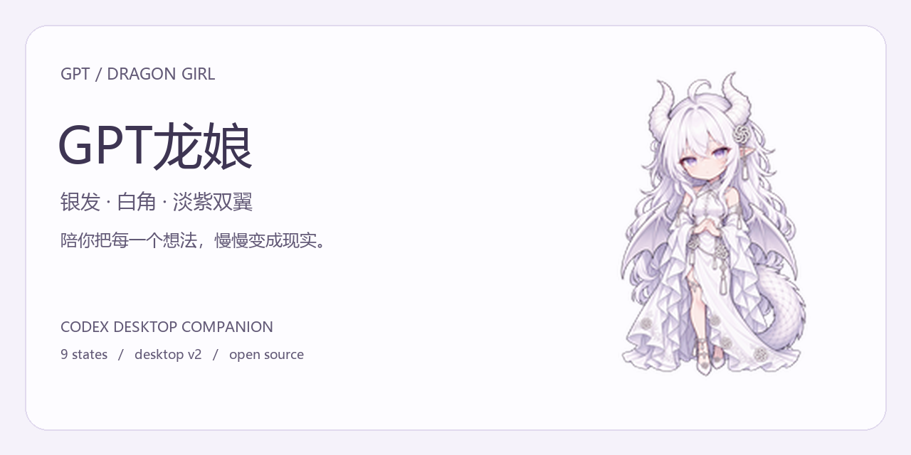
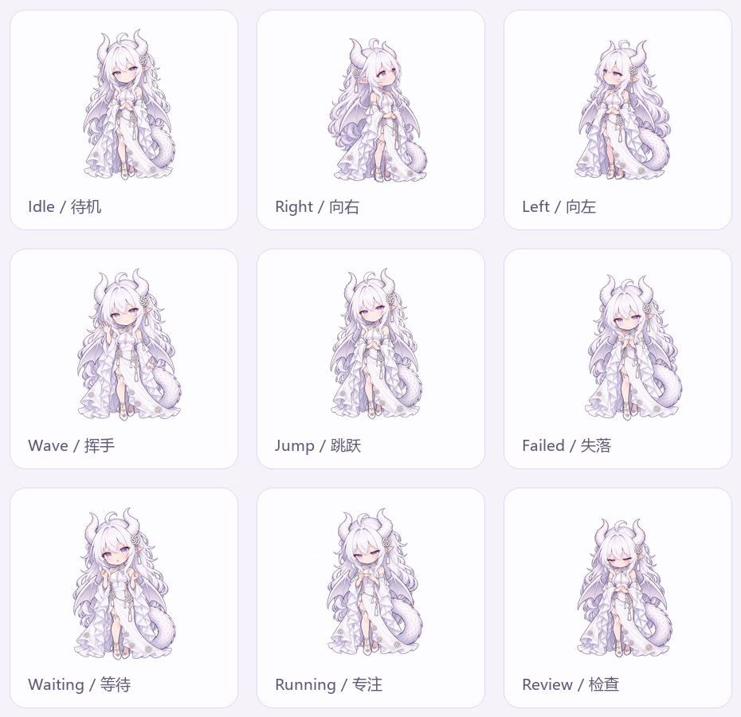

<p align="center"></p>

# GPT龙娘 · Codex Dragon Pet

白发紫眸、白色龙角、淡紫双翼与长尾的 GPT 拟人桌宠，陪你在 Codex 桌面工作。保留原生宠物选择和切换体验，附离线安装 skill 与可复现的精灵图构建脚本。

<p align="center"></p>

预览来自真实精灵帧，每帧 120ms；这是展示节奏，实际播放由宿主控制。

## 状态预览



九种状态：待机、向右、向左、挥手、跳跃、失落、等待、专注、检查。动画主要由静态姿态的小幅位移组成；16个指针方向槽复用四种方向素材，并非16幅独立绘制视角。

## 安装

下载 [v1.0.0 安装包](https://github.com/ouyang070125-cmyk/codex-dragon-pet/releases/tag/v1.0.0) 或仓库 ZIP 并解压。在解压目录运行（安装无需额外 Python 包、无需联网）：

```sh
python skills/install-gpt-dragon-pet/scripts/install_pet.py
```

打开 **设置 → 虚拟宠物 → 刷新**，选择 **GPT龙娘**。可随时切换其他宠物；安装脚本不改变当前选择。

脚本默认安装到 `~/.codex/pets/gpt-dragon`；设置了 `CODEX_HOME` 时使用其 `pets` 子目录。同内容重复安装直接成功，不同内容的同名目录会停止覆盖。

也可以手动将 `skills/install-gpt-dragon-pet/assets/gpt-dragon` 整个文件夹复制到上述 pets 目录，保留其中 `pet.json` 和 `spritesheet.webp`。

### 通过 skill 安装

将 `skills/install-gpt-dragon-pet` 文件夹复制到 `~/.codex/skills/`（自定义 `CODEX_HOME` 时使用其 `skills/`），刷新 skills 后请求：“使用 install-gpt-dragon-pet 安装GPT龙娘”。skill 使用同一个离线安装脚本。

### 官方安装链接

支持的客户端可使用 `codex://pets/install`，参数为 `name`、HTTPS `imageUrl`、`description` 和 `spriteVersionNumber=2`。GitHub 可能不允许点击自定义协议，请复制完整链接到系统支持的打开方式。手动安装仍是可靠入口。

可复制下列 v1.0.0 安装链接（使用固定版本图集）：

```text
codex://pets/install?name=GPT%E9%BE%99%E5%A8%98&imageUrl=https%3A%2F%2Fraw.githubusercontent.com%2Fouyang070125-cmyk%2Fcodex-dragon-pet%2Fv1.0.0%2Fskills%2Finstall-gpt-dragon-pet%2Fassets%2Fgpt-dragon%2Fspritesheet.webp&description=%E7%99%BD%E5%8F%91%E7%B4%AB%E7%9C%B8%E3%80%81%E9%BE%99%E8%A7%92%E5%8F%8C%E7%BF%BC%E4%B8%8E%E9%95%BF%E5%B0%BE%E7%9A%84+GPT+%E6%8B%9F%E4%BA%BA%E6%A1%8C%E5%AE%A0%E3%80%82&spriteVersionNumber=2
```

[官方链接参数说明](https://learn.chatgpt.com/docs/app/commands)

## 兼容性与格式

- 原包在用户的 Windows 桌面宠物列表中使用，截图显示可选中并展示。此次发布另行验证文件、离线重建及安装行为；不将截图当作所有状态的运行测试。
- macOS、Linux、CLI 和网页版未进行实机测试，不承诺兼容。
- 桌面 v2 图集为 **1536×2288**，8列11行，单格192×208；不能直接当成网页版1536×1872上传素材。
- 前9行动作有效帧数为 `[6,8,8,4,5,8,6,6,6]`。第0行第6列为中立视角保留帧，不参与待机循环；第0行第7列透明。最后两行是16个指针方向槽。
- 本项目是社区宠物素材与安装工具，不包含或修改 Codex 程序，不是 OpenAI 官方插件。

## 从源图构建

Python 3.10+；发布构建环境为 Python 3.14、Pillow 12.3.0。

```sh
python -m pip install -r requirements-build.txt
python scripts/build_pet.py --source-dir sources --output-dir build/gpt-dragon
```

构建仅写指定输出目录，不安装、不切换宠物、不调用在线模型。`sources/` 包含基础角色、表情姿态和方向姿态三张图。`scripts/preview.py` 可重新生成文档预览，中文字体默认使用 Windows 微软雅黑，其他平台会回退字体。

## 许可与制作说明

代码与 skill：**MIT**，见 [LICENSE](LICENSE)。美术源图、图集及派生预览：**CC BY 4.0**，见 [ASSET-LICENSE.md](ASSET-LICENSE.md)。使用素材时保留署名、许可链接并说明修改。

角色参考由项目所有者提供并确认拥有原画权利；源图经 AI 辅助生成，动画图集由 Python/Pillow 合成。请保留 [署名说明](ATTRIBUTION.md)。

## English

GPT Dragon Girl is a silver-haired dragon companion for the Codex desktop pet picker. This repository includes the original desktop v2 atlas, three source images, an offline installer skill, and a reproducible Pillow builder. Run `python skills/install-gpt-dragon-pet/scripts/install_pet.py`, refresh Settings → Pets, and select GPT龙娘. An identical installation is a no-op; conflicting files are never overwritten. Desktop atlas: 1536×2288, including its reserved neutral-look frame. Other platforms and web upload are untested. Code: MIT. Artwork: CC BY 4.0. Preview GIF timing is illustrative.
